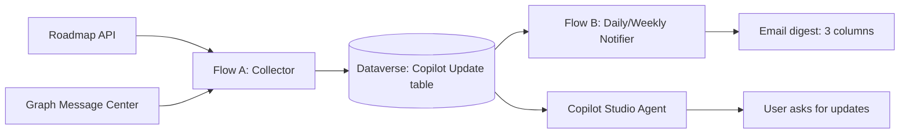

# Lab Guide (Step-by-step): Copilot Updates Tracker with Dataverse, Power Automate, and Copilot Studio

This guide is written as an exact build sequence so a new user can follow it without guessing.

## 0) What you are building

You will build one solution with:

1. **Flow A** `Copilot Updates - Collector` (scheduled ingestion + Dataverse upsert)
2. **Flow B** `Copilot Updates - Daily Change Notifier` (daily/weekly digest email)
3. **Copilot Studio agent** `Copilot Updates Analyst` (query + optional on-demand email)



---

## 1) Prerequisites

You need:

- Power Apps + Power Automate + Copilot Studio access
- Permission to create Dataverse tables and cloud flows
- Entra app registration permission (or admin help)
- Graph application permission consent for `ServiceMessage.Read.All`

Tenant placeholders used in this guide:

- `<TENANT_ID>`
- `<CLIENT_ID>`
- `<CLIENT_SECRET>`
- `<DATAVERSE_TABLE_LOGICAL_NAME>` (example: `cra2f_copilotupdates`)
- `<DATAVERSE_PRIMARY_KEY_LOGICAL_NAME>` (example: `cra2f_copilotupdateid`)

---

## 2) Create Dataverse table (exact schema first)

Create one canonical table:

- **Display name:** `Copilot Update`
- **Logical name:** `<DATAVERSE_TABLE_LOGICAL_NAME>`

Create these columns (logical names may vary by environment prefix):

| Display name | Type | Purpose |
|---|---|---|
| UpdateKey | Single line of text | Unique key for upsert (`roadmap-...` or `mc-...`) |
| External Id | Single line of text | Native source id |
| Source | Choice/Text | `Roadmap` or `MessageCenter` |
| Title | Multiple lines of text | Brief title |
| Description | Multiple lines of text | Details used in email |
| Record Hash | Single line of text | Detect change |
| Previous Hash | Single line of text | Keep last version hash |
| Change Type | Choice/Text | `New`, `Updated`, `Unchanged` |
| Last Seen On | Date and time | Last collector observation |
| Last Change On | Date and time | Last detected content change |
| Last Notified On | Date and time | Last digest send timestamp |

Create alternate key:

- **Key name:** `UpdateKey Key`
- **Column:** `UpdateKey`

---

## 3) Create Entra app for Message Center (Graph app-only)

1. Go to **Microsoft Entra admin center** -> **App registrations** -> **New registration**  
   Name: `Copilot-Updates-Collector`
2. In **API permissions** -> **Add a permission** -> **Microsoft Graph** -> **Application permissions**
3. Add `ServiceMessage.Read.All`
4. Click **Grant admin consent**
5. In **Certificates & secrets**, create a client secret and save:
   - Tenant ID
   - Client ID
   - Client secret value

---

## 4) Build Flow A: `Copilot Updates - Collector`

### 4.1 Create flow shell

1. Power Automate -> **Create** -> **Scheduled cloud flow**
2. Name: `Copilot Updates - Collector`
3. Start with frequency every 6 hours (adjust later)

### 4.2 Add source HTTP actions

1. Add **HTTP** action for Roadmap source (`HTTP`)
2. Add **HTTP** action for Message Center (`HTTP_1`) using app-only OAuth:
   - Audience: `https://graph.microsoft.com`
   - Endpoint:
     `https://graph.microsoft.com/v1.0/admin/serviceAnnouncement/messages?$top=100`
   - Tenant/client/secret from Step 3

### 4.3 Add the exact loop input expression (critical)

Add **Apply to each** and set input from **Expression** (not plain text):

```text
@union(coalesce(body('HTTP')?['value'], json('[]')), coalesce(body('HTTP_1')?['value'], json('[]')))
```

This must be entered from the Expression tab. If typed as literal text, the loop breaks with type String errors.

### 4.4 Inside Apply to each: compose fields

Add **Compose** actions:

1. **Compose - UpdateKey**
```text
@if(equals(coalesce(item()?['source'],'Roadmap'),'MessageCenter'), concat('mc-', string(item()?['id'])), concat('roadmap-', string(item()?['id'])))
```

2. **Compose - RecordHash** (use fields you mapped in your normalization)
```text
@concat(
  coalesce(item()?['title'],''),
  '|',
  coalesce(item()?['status'],''),
  '|',
  coalesce(item()?['lastModifiedDateTime'], coalesce(item()?['modifiedDateTime'],'')),
  '|',
  coalesce(item()?['description'],'')
)
```

> If your normalized object uses different property names, keep the same pattern and replace field names only.

### 4.5 Dataverse lookup (must include primary key)

Add **Dataverse - List rows**:

- Table: `Copilot Update`
- Filter rows (replace logical name with your own):
```text
cra2f_updatekey eq '@{outputs('Compose_-_UpdateKey')}'
```
- Top count: `1`
- Select columns: include **primary key logical name** + `recordhash`

Example select:
```text
cra2f_copilotupdateid,cra2f_recordhash,cra2f_updatekey
```

### 4.6 Upsert logic

Add conditions:

1. If `length(body('List_rows')?['value'])` equals `0` -> **Add a new row** (`Change Type = New`)
2. Else compare `RecordHash` vs existing hash:
   - Different -> **Update a row** (`Change Type = Updated`, move previous hash)
   - Same -> **Update a row** (`Change Type = Unchanged`, update Last Seen On only)

For **Update a row**:

- **Row ID** must map to Dataverse unique identifier from List rows result
- Do not map Row ID to External Id
- Do not leave Row ID expression empty

---

## 5) Build Flow B: `Copilot Updates - Daily Change Notifier`

### 5.1 Create flow shell

1. Create scheduled flow named `Copilot Updates - Daily Change Notifier`
2. Start with daily recurrence (you can switch to weekly later)

### 5.2 Query changed records

Use Dataverse **List rows** with your time window and notification guard:

- Changed in last window (`Last Change On`)
- Not already notified for same window (`Last Notified On`)

### 5.3 Condition: send only if rows exist

Condition expression:

```text
@greater(length(body('List_rows')?['value']), 0)
```

If **Yes** branch:

1. Build HTML table with only 3 columns:
   - Message Center ID or Roadmap ID
   - Brief Title
   - Description / Update Details
2. Send email
3. Update each sent row `Last Notified On = utcNow()`

### 5.4 HTML body template (exact 3-column layout)

Use **Compose** (or directly in Send email body):

```html
<h2>Copilot Updates - Change Digest</h2>
<p>New or changed updates detected in the configured window.</p>
<table border="1" cellpadding="6" cellspacing="0" style="border-collapse:collapse;">
  <thead>
    <tr>
      <th>Message Center ID or Roadmap ID</th>
      <th>Brief title</th>
      <th>Description / update details</th>
    </tr>
  </thead>
  <tbody>
    <!-- Populate with dynamic rows from List rows -->
  </tbody>
</table>
```

---

## 6) Copilot Studio agent: `Copilot Updates Analyst`

### 6.1 Create/confirm agent

- Agent name: `Copilot Updates Analyst`

### 6.2 Add tools

Add these tools:

1. **Dataverse list rows** (to fetch update records)
2. **Send an email (V2)** (optional on-demand send from chat)

### 6.3 Add 4 skills and route by user choice

Add these skills:

- `cowork-update-information`
- `copilot-studio-information`
- `copilot-information`
- `other-m365-information`

In instructions, require the user to choose one workflow first, then route to the matching skill.

### 6.4 Email options used in this lab

Two supported options:

1. **Scheduled email (recommended):** Flow B sends digest automatically (daily/weekly)
2. **On-demand email from agent:** Agent uses **Send an email (V2)** when user asks

For **Send an email (V2)** in agent/tool actions, use:

| Field | Value |
|---|---|
| To | Target recipient list |
| Subject | `Copilot Updates - Summary` (or include date) |
| Body | HTML digest table (same 3-column format as Flow B) |
| Is HTML | `true` |

Recommended instruction snippet for agent:

```text
When user asks to email updates, use Send an email (V2) with the same 3-column digest format used by the notifier flow.
```

---

## 7) Switch digest from daily to weekly

For weekly digest:

1. Open `Copilot Updates - Daily Change Notifier`
2. Edit **Recurrence**
3. Set:
   - Frequency: `Week`
   - Interval: `1`
   - Select weekday/timezone/time
4. Save and test run

---

## 8) End-to-end validation (run in this order)

1. Run Collector manually
2. Confirm rows are inserted/updated in Dataverse
3. Re-run Collector with same payload (no duplicate rows expected)
4. Trigger change/new payload and run Collector again (Updated/New states expected)
5. Run Notifier and verify email contains exactly 3 columns
6. Confirm `Last Notified On` updated for sent rows
7. Ask agent for latest updates and verify response is Dataverse-backed

---

## Appendix A: Common issues and fixes (not a build step)

### A) `Apply_to_each` type String error
- Cause: loop input entered as text
- Fix: re-enter expression from Expression tab:
```text
@union(coalesce(body('HTTP')?['value'], json('[]')), coalesce(body('HTTP_1')?['value'], json('[]')))
```

### B) `Update a row` recordId null
- Cause: List rows did not return primary key or Row ID mapped incorrectly
- Fix:
  - Include primary key in Select columns
  - Map Row ID to Dataverse unique identifier token from List rows output

### C) Message Center permission failure
- Cause: wrong permission mode or no admin consent
- Fix:
  - Use **Application** permission (`ServiceMessage.Read.All`)
  - Re-grant admin consent
  - Validate secret is active

---

## Appendix B: Artifacts used in this lab

- Dataverse table: `Copilot Update`
- Flow A: `Copilot Updates - Collector`
- Flow B: `Copilot Updates - Daily Change Notifier`
- Agent: `Copilot Updates Analyst`
- Entra app: `Copilot-Updates-Collector`
