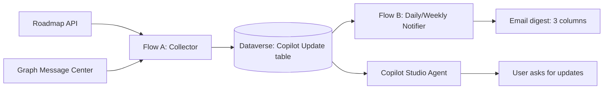

# Lab: Build a Copilot Updates Tracker (Dataverse + Power Automate + Copilot Studio)

## Key concepts before you build

This lab uses a split design:

- **Flow A (Collector):** ingest updates from Roadmap + Message Center and upsert into Dataverse
- **Flow B (Notifier):** detect changes and send an HTML digest email
- **Copilot Studio agent:** let users query the same dataset and optionally send on-demand email

This separation makes ingestion reliable and keeps the agent focused on user interaction.

## Scenario

You are implementing an internal Copilot updates tracker. The system should:

1. Collect updates from Microsoft sources
2. Store normalized records in Dataverse
3. Detect new/changed records
4. Send digest emails in a clean 3-column format
5. Expose the same information through a Copilot Studio agent

## Lab outcomes

By the end of this lab, you will have:

- Dataverse table `Copilot Update` with deterministic upsert keying
- `Copilot Updates - Collector` flow running on schedule
- `Copilot Updates - Daily Change Notifier` flow sending digest emails
- `Copilot Updates Analyst` agent configured with Dataverse and email tools

## Solution architecture diagram



---

## Table of contents

1. [Exercise 1 - Prerequisites and setup values](#exercise-1---prerequisites-and-setup-values)
2. [Exercise 2 - Create Dataverse table](#exercise-2---create-dataverse-table)
3. [Exercise 3 - Create Entra app (Message Center)](#exercise-3---create-entra-app-message-center)
4. [Exercise 4 - Build Flow A: Collector](#exercise-4---build-flow-a-collector)
5. [Exercise 5 - Build Flow B: Notifier](#exercise-5---build-flow-b-notifier)
6. [Exercise 6 - Configure Copilot Studio agent](#exercise-6---configure-copilot-studio-agent)
7. [Exercise 7 - Switch digest to weekly](#exercise-7---switch-digest-to-weekly)
8. [Exercise 8 - Validate end-to-end](#exercise-8---validate-end-to-end)
9. [Appendix A - Common issues and fixes](#appendix-a---common-issues-and-fixes)
10. [Appendix B - Artifacts used](#appendix-b---artifacts-used)

---

## Exercise 1 - Prerequisites and setup values

### Step 1: Confirm access

You need:

- Power Apps + Power Automate + Copilot Studio access
- Permission to create Dataverse tables and flows
- Permission (or admin help) to create Entra app registrations
- Ability to grant Graph application consent

### Step 2: Capture setup placeholders

- `<TENANT_ID>`
- `<CLIENT_ID>`
- `<CLIENT_SECRET>`
- `<DATAVERSE_TABLE_LOGICAL_NAME>` (example: `cra2f_copilotupdates`)
- `<DATAVERSE_PRIMARY_KEY_LOGICAL_NAME>` (example: `cra2f_copilotupdateid`)

---

## Exercise 2 - Create Dataverse table

### Step 1: Create canonical table

- **Display name:** `Copilot Update`
- **Logical name:** `<DATAVERSE_TABLE_LOGICAL_NAME>`

### Step 2: Create columns

| Display name | Type | Purpose |
|---|---|---|
| UpdateKey | Single line of text | Unique upsert key (`roadmap-...` or `mc-...`) |
| External Id | Single line of text | Source record id |
| Source | Choice/Text | `Roadmap` or `MessageCenter` |
| Title | Multiple lines of text | Brief title |
| Description | Multiple lines of text | Update details |
| Record Hash | Single line of text | Detect content changes |
| Previous Hash | Single line of text | Keep prior hash |
| Change Type | Choice/Text | `New`, `Updated`, `Unchanged` |
| Last Seen On | Date/time | Last collector run touch |
| Last Change On | Date/time | Last detected content change |
| Last Notified On | Date/time | Last email send time |

### Step 3: Create alternate key

- **Key name:** `UpdateKey Key`
- **Column:** `UpdateKey`

---

## Exercise 3 - Create Entra app (Message Center)

### Step 1: Register app

In Microsoft Entra admin center:

1. **App registrations** -> **New registration**
2. Name: `Copilot-Updates-Collector`

### Step 2: Add Graph permission

1. **API permissions** -> **Add a permission** -> **Microsoft Graph** -> **Application permissions**
2. Add `ServiceMessage.Read.All`
3. Grant admin consent

### Step 3: Create secret

From **Certificates & secrets**, create a client secret and store:

- Tenant ID
- Client ID
- Client secret value

---

## Exercise 4 - Build Flow A: Collector

Flow name: `Copilot Updates - Collector`

### Step 1: Create schedule trigger

Create a scheduled cloud flow with a 6-hour recurrence.

### Step 2: Add source HTTP actions

1. `HTTP` (Roadmap source)
2. `HTTP_1` (Message Center via Graph app-only)
   - Endpoint:
     `https://graph.microsoft.com/v1.0/admin/serviceAnnouncement/messages?$top=100`

### Step 3: Configure Apply to each input (exact expression)

In **Apply to each**, use Expression mode:

```text
@union(coalesce(body('HTTP')?['value'], json('[]')), coalesce(body('HTTP_1')?['value'], json('[]')))
```

### Step 4: Compose identity and change hash

Add `Compose - UpdateKey`:

```text
@if(equals(coalesce(item()?['source'],'Roadmap'),'MessageCenter'), concat('mc-', string(item()?['id'])), concat('roadmap-', string(item()?['id'])))
```

Add `Compose - RecordHash`:

```text
@concat(
  coalesce(item()?['title'],''),
  '|',
  coalesce(item()?['status'],''),
  '|',
  coalesce(item()?['lastModifiedDateTime'], coalesce(item()?['modifiedDateTime'],'')),
  '|',
  coalesce(item()?['description'],'')
)
```

### Step 5: Add Dataverse lookup

Add **List rows** on `Copilot Update`:

- Filter rows:
```text
cra2f_updatekey eq '@{outputs('Compose_-_UpdateKey')}'
```
- Top count: `1`
- Select columns must include primary key + hash

Example:

```text
cra2f_copilotupdateid,cra2f_recordhash,cra2f_updatekey
```

### Step 6: Add upsert branches

1. If no row found (`length(...) = 0`) -> **Add a new row** (`Change Type = New`)
2. Else compare hashes:
   - Changed -> **Update a row** (`Change Type = Updated`)
   - Same -> **Update a row** (`Change Type = Unchanged`)

For `Update a row`, map **Row ID** to Dataverse unique identifier from `List rows` output.

---

## Exercise 5 - Build Flow B: Notifier

Flow name: `Copilot Updates - Daily Change Notifier`

### Step 1: Create schedule trigger

Create scheduled cloud flow (daily by default).

### Step 2: Query changed rows

Use Dataverse **List rows** to return only changed/unnotified rows for the selected time window.

### Step 3: Add condition before sending

```text
@greater(length(body('List_rows')?['value']), 0)
```

If true:

1. Build HTML with 3 columns
2. Send email
3. Update `Last Notified On = utcNow()` for rows sent

### Step 4: Use this HTML structure

```html
<h2>Copilot Updates - Change Digest</h2>
<p>New or changed updates detected in the configured window.</p>
<table border="1" cellpadding="6" cellspacing="0" style="border-collapse:collapse;">
  <thead>
    <tr>
      <th>Message Center ID or Roadmap ID</th>
      <th>Brief title</th>
      <th>Description / update details</th>
    </tr>
  </thead>
  <tbody>
    <!-- Populate dynamic rows from List rows -->
  </tbody>
</table>
```

---

## Exercise 6 - Configure Copilot Studio agent

Agent name: `Copilot Updates Analyst`

### Step 1: Add tools

1. Dataverse list rows tool
2. Send an email (V2)

### Step 2: Add workflow skills

- `cowork-update-information`
- `copilot-studio-information`
- `copilot-information`
- `other-m365-information`

### Step 3: Add routing instruction

Require users to select one workflow first, then route to the matching skill.

### Step 4: Configure email action fields

For **Send an email (V2)**:

| Field | Value |
|---|---|
| To | Target recipients |
| Subject | `Copilot Updates - Summary` (optionally add date) |
| Body | HTML digest (same 3-column format) |
| Is HTML | `true` |

Suggested instruction text:

```text
When user asks to email updates, use Send an email (V2) with the same 3-column digest format used by the notifier flow.
```

---

## Exercise 7 - Switch digest to weekly

1. Open `Copilot Updates - Daily Change Notifier`
2. Edit **Recurrence**
3. Set:
   - Frequency = `Week`
   - Interval = `1`
   - Desired weekday/time/timezone
4. Save and run a test

---

## Exercise 8 - Validate end-to-end

Run in this sequence:

1. Run Collector manually
2. Confirm rows inserted/updated in Dataverse
3. Re-run Collector with same payload (no duplicates)
4. Introduce changed data and rerun (Updated/New expected)
5. Run Notifier and confirm 3-column email output
6. Confirm `Last Notified On` updates
7. Ask agent for latest changes and confirm Dataverse-backed results

---

## Appendix A - Common issues and fixes

### A1) `Apply_to_each` input resolves as String

- Cause: expression entered as plain text
- Fix:
```text
@union(coalesce(body('HTTP')?['value'], json('[]')), coalesce(body('HTTP_1')?['value'], json('[]')))
```

### A2) `Update a row` fails with null `recordId`

- Cause: primary key not selected or Row ID mapped incorrectly
- Fix:
  - Include primary key in List rows select columns
  - Map Row ID from Dataverse unique identifier token in List rows output

### A3) Graph Message Center permission errors

- Cause: delegated permission used or admin consent missing
- Fix:
  - Use Graph **Application** permission `ServiceMessage.Read.All`
  - Re-grant admin consent
  - Confirm active client secret

---

## Appendix B - Artifacts used

- Dataverse table: `Copilot Update`
- Flow A: `Copilot Updates - Collector`
- Flow B: `Copilot Updates - Daily Change Notifier`
- Agent: `Copilot Updates Analyst`
- Entra app: `Copilot-Updates-Collector`
